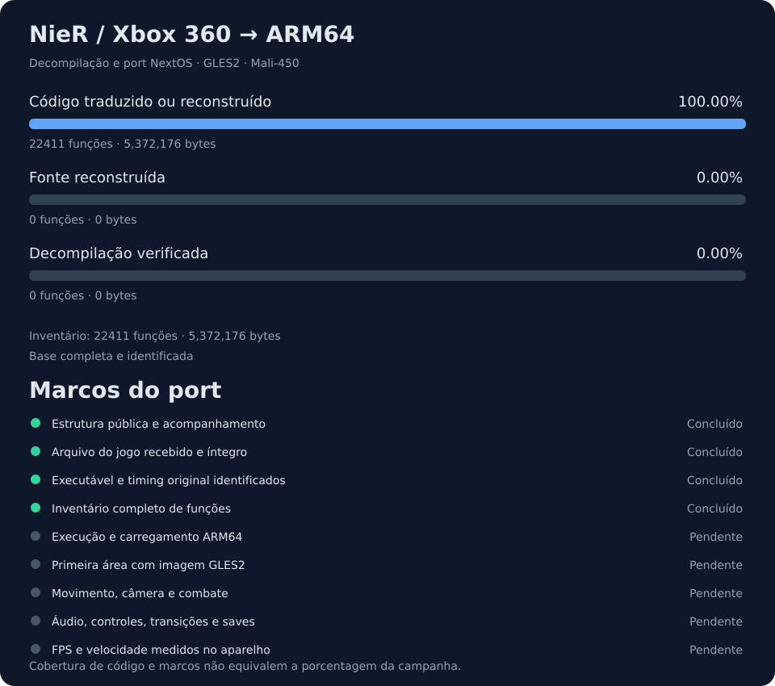
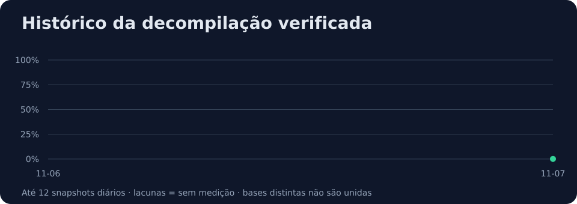

# NieR — Decompilation & NextOS Port

[English](#english) · [Metodologia](docs/METRICS.md) · [Plano](docs/ROADMAP.md) · [Reaproveitamento](docs/REUSE.md) · [Atualizações](CHANGELOG.md)


Projeto independente de engenharia reversa do **NieR original de Xbox 360 (2010)**, com destino a **ARM64 / NextOS / GLES2 / Mali-450**. O objetivo é gameplay funcional, velocidade original preservada e desempenho medido no aparelho.

**Estado inicial:** estrutura e acompanhamento preparados. A cópia do jogo está em download; o executável ainda não foi analisado. Ainda não há build do NieR, gameplay ou FPS medidos neste projeto. A porcentagem fica **não medida** até existir um inventário completo identificado por SHA-256.

## Acompanhamento





Os gráficos são gerados dos registros em [`progress/`](progress/). O [relatório detalhado](docs/generated/STATUS.md) separa código recompilado, decompilado e verificado. A porcentagem principal usa **bytes de funções decompiladas com evidência de validação / bytes de todas as funções do inventário fixado**. Isso mede cobertura de código; não representa porcentagem da campanha jogável.

## Base técnica

Vamos aproveitar a experiência dos nossos ports de **Rayman Origins (Xbox 360), Black, Genma Onimusha e Devil May Cry**. O Rayman fornece a referência principal da rota PowerPC → ARM64 e do renderizador GLES2 próprio. As soluções dos demais jogos serão adaptadas somente onde houver compatibilidade demonstrada. Veja o [mapa de reaproveitamento](docs/REUSE.md).

O trabalho combina recompilação estática para execução, reconstrução de funções em C/C++ para entendimento e otimização, e adaptação do caminho gráfico para GLES2. Gerar código recompilado não conta como decompilação verificada.

## Atualizar o progresso

Requer Python 3.11 ou superior, sem dependências adicionais.

```sh
# Atualize o inventário, evidências e marcos antes de gerar o painel.
python3 tools/progress.py --snapshot
python3 -m unittest discover -s tests -v
python3 tools/progress.py --check
```

Inclua os registros e os gráficos no mesmo commit da alteração. O CI recusa painéis desatualizados e valida os cálculos. Os resultados de cada etapa entram no [changelog](CHANGELOG.md); as instruções estão em [CONTRIBUTING.md](CONTRIBUTING.md).

## Dados do jogo

Este repositório publica ferramentas, documentação, metadados de análise e código original do projeto. Executáveis comerciais, imagens de disco, arquivos do jogo, chaves, saves pessoais e saída automática da recompilação ficam fora do Git. Uma futura ferramenta de preparo usará os arquivos fornecidos localmente pelo usuário. Não há download do jogo neste repositório.

NieR e suas marcas pertencem aos respectivos titulares. Projeto sem vínculo ou endosso da Square Enix, Cavia ou Microsoft.

## English

Independent reverse engineering of the original **2010 Xbox 360 NieR**, targeting **ARM64 / NextOS / GLES2 / Mali-450**. Development builds on our existing console-port experience, especially the Xbox 360 Rayman Origins runtime and native GLES2 rendering work.

**Current status: project setup only.** The game executable has not been analyzed. There is no NieR build, gameplay capture or measured performance yet. Verified decompilation percentage remains **unmeasured** until a complete function inventory is tied to an executable hash. Recompilation, reconstructed source, verified source and port milestones are tracked separately. Commercial game files and generated recompilation output are excluded.

Original repository tooling and documentation are under the [MIT license](LICENSE). Any future reused third-party code must retain its own license and notices.
