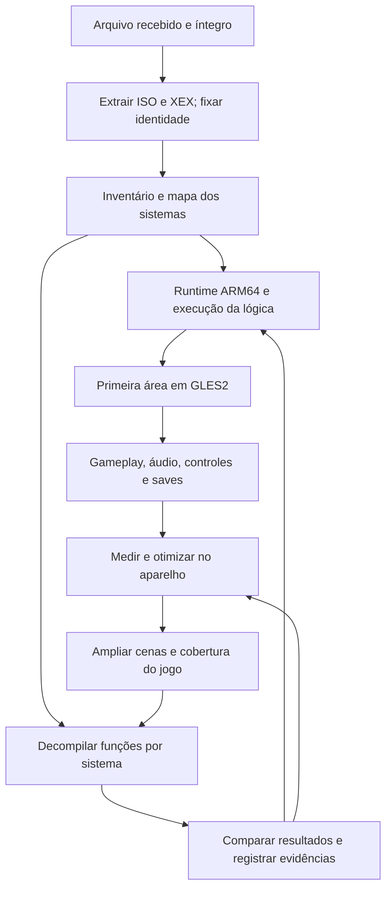

# Plano de decompilação e port do NieR

Data: 07/11/2026. Alvo: **NieR original de Xbox 360 (2010), variante Gestalt**, em **ARM64 / NextOS / GLES2 / Mali-450**.

## Resultado pretendido

Recuperar e documentar a lógica necessária para executar o jogo corretamente, construir seu caminho gráfico GLES2 e otimizar o gameplay no aparelho. O trabalho deve produzir funções reconstruídas verificáveis, um port funcional e medições reproduzíveis de desempenho. A cobertura de código e a cobertura de gameplay serão acompanhadas separadamente.

A estratégia é combinar **recompilação estática para executar o código ainda não reconstruído**, **decompilação por sistemas** e **reimplementação nativa dos trechos que precisarem de adaptação ou otimização**. O jogo pode chegar ao gameplay enquanto a decompilação continua; o painel mantém a distinção entre essas etapas.

Não há prazo ou meta numérica de FPS estabelecidos. Os perfis de desenho x2/x3/x4 serão comparados preservando a cadência original confirmada externamente. A meta de desempenho para entrega deve ser explicitada antes de declarar o resultado jogável/aprovado.

## Estado de partida

- Repositório público, gerador de gráficos, metodologia e validações de progresso prontos.
- Arquivo `NieR (USA, Europe) (En).7z` recebido: **5.603.939.951 bytes**, teste integral do 7-Zip aprovado.
- SHA-256 do arquivo: `f6a8c194708482d2fd8fa70520b6a5e8dd38b87d016a1c1099cf40d7ac80bc67`.
- A entrada do arquivo é `NieR (USA, Europe) (En).iso`, com **7.838.695.424 bytes**. Essa identificação ainda não substitui a leitura do XEX.
- ISO e `default.xex` ainda não extraídos/analisados neste projeto; não há funções inventariadas, build do NieR, renderização ou desempenho medidos.

A [evidência de recebimento](../evidence/input-20261107.md) fixa essa origem. Preservar os dados e as provas já válidas; esta etapa não pede outro download ou repetição do teste integral do arquivo.

## Bases nossas e ordem de reaproveitamento

| Referência aprovada | Uso no NieR | Adaptação necessária |
| --- | --- | --- |
| **DMC3 HD de Xbox 360**, versão 1.0.1, fonte `9c96aab` | Primeira comparação para recompilação PowerPC → ARM64, organização do renderer 3D GLES2, cadência, shaders e substituições nativas | Examinar imports e contratos do NieR antes de selecionar componentes; materiais, estruturas e pontos de interceptação são específicos de cada engine |
| **Rayman Origins de Xbox 360**, fonte `808373501d6a` | Integração ReXGlue, serviços já implementados, thread de render, cache gráfico, diagnóstico de banda e mipmaps | Comparar com o runtime do DMC3 e escolher a base que atender ao NieR com menos adaptações; os hooks do Rayman não identificam funções do NieR |
| **Black**, fonte `b3a8560` | Diagnóstico de apresentação, separação entre atualização e desenho, medição no Mali-450 | Sua origem é Xbox original; aplicar receitas compatíveis, mantendo a tradução de CPU própria de Xbox 360 |
| **Genma Onimusha**, fonte `7133884` | Referência externa de velocidade, eliminação de espera dupla e apresentação correta | Confirmar a temporização do NieR e seus pontos de espera |
| **Wario / Skate 3** | Complementos de cadência e ownership/apresentação SDL quando aplicáveis | Reusar somente contratos presentes na implementação selecionada |

Essas versões foram identificadas pelos registros de entrega aprovados. Antes de importar código ou objetos, recuperar commit completo, licença, hashes dos artefatos, toolchain, sysroot e alterações cumulativas. Manter as referências intactas e aproveitar seus caches apenas quando os inputs forem compatíveis. O [mapa de reaproveitamento](REUSE.md) registra os limites.

## Sequência técnica

### 1. Identidade e referência original

**Ações:**

1. Extrair o arquivo para a área privada de trabalho no SSD e conservar o arquivo recebido. Usar o extrator de disco já empregado nos nossos projetos quando ele suportar a partição Xbox 360 deste ISO.
2. Registrar SHA-256 do ISO, do `default.xex` e dos arquivos consumidos pelo preparo; identificar região, versão, Title ID, Media ID, atualizações presentes e disposição do disco.
3. Identificar as seções de código/dados do XEX, entrada, bibliotecas/imports e requisitos reais. Registrar como o executável foi preparado para análise, preservando o original.
4. Na primeira hora da implementação, estabelecer a referência externa de timing: vídeo de hardware original ou Xenia, quadros distintos em movimento e duração de corrida/golpe. Presumir lógica a 60 Hz até prova externa em contrário. Cadência visual e frequência lógica devem ter evidências próprias; um vídeo sozinho pode não expor todos os passos internos.

**Saída:** manifesto privado dos dados, identidade pública sanitizada do executável e referência de timing com fonte, trecho e limites. O marco de identidade só termina quando XEX e timing estiverem estabelecidos. Enquanto faltar a referência externa, continuar a análise estática e não certificar velocidade original.

### 2. Inventário e mapa de sistemas

**Ações:**

1. Aplicar as ferramentas de análise/recompilação da base selecionada ao XEX. Resolver regiões de código, limites de funções, chamadas indiretas e tabelas de salto que o analisador não reconhecer corretamente.
2. Usar a decompilação assistida para nomear funções e reconstruir tipos a partir de referências cruzadas, strings, acessos à memória e chamadas observadas. Identificar código de bibliotecas separadamente da engine, preservando a regra do denominador publicado.
3. Classificar os sistemas: inicialização, arquivos/descompressão, relógio e loop, jobs/threads, mapa/entidades, câmera, animação/skinning, combate/magia, colisão, renderização, interface, áudio/vídeos e saves.
4. Mapear containers e formatos efetivamente presentes, incluindo modelos, materiais, texturas e shaders. Ferramentas externas de assets são candidatas até serem confirmadas contra esses bytes.
5. Importar funções em `progress/functions.json` com endereço e tamanho original, inicialmente como `discovered`. Revisar cobertura, sobreposições e falsos positivos antes de marcar o inventário completo.

**Saída:** mapa de chamadas e estruturas, catálogo de assets e inventário revisado. A porcentagem global permanece indisponível enquanto o inventário for parcial. Nenhum número de funções ou nome de engine será presumido antes dessa análise.

### 3. Runtime ARM64 e execução

**Ações:**

1. Comparar os imports e requisitos encontrados com DMC3 e Rayman. Fixar a combinação de tradutor, loader e runtime que cubra os contratos necessários; registrar a escolha antes da integração.
2. Gerar o código de tradução em área privada e compilar para ARM64 com a toolchain compatível já usada nos ports aprovados. Registrar avisos, instruções pendentes e a resolução de chamadas indiretas.
3. Preservar o modelo de endereços guest, endianness, ABI, operações vetoriais e comportamento de ponto flutuante. Compilar para ARM64 não elimina automaticamente o custo dessas traduções.
4. Implementar os serviços usados pelo NieR: memória, arquivos, sincronização, tempo, threads, controle e os caminhos de áudio/vídeo que bloquearem o avanço. Substituir primeiro bibliotecas reconhecidas por implementações compatíveis quando houver base nossa verificada.
5. Instrumentar inicialização, carregamento e entrada no loop real. Um serviço que retornar sucesso sem cumprir seu contrato deve permanecer como pendência, com erro observável.

**Saída:** execução identificada por hash, capaz de carregar os dados e avançar pela lógica real. A primeira execução dinâmica deve usar o aparelho autorizado; abrir jogo/emulador no PC depende de autorização específica. O host prepara ferramentas, build, dados e provas diferenciais que não exigirem abrir o jogo.

### 4. Primeiro caminho gráfico GLES2

**Ações:**

1. Localizar as estruturas e funções que produzem os desenhos. Comparar o nível de interceptação usado no DMC3 e no Rayman e selecionar o caminho que preserve corretamente a cena do NieR.
2. Mapear vértices, índices, constantes, texturas, samplers, blend, depth/stencil e render targets. Implementar os estados necessários ao primeiro trecho jogável.
3. Preparar no PC os shaders e recursos desse trecho para GLES2/ESSL100, respeitando precisão e formatos da Mali-450. Registrar produtor e consumidor dos dados transformados e cada adaptação sem equivalência direta.
4. Dar prioridade a cenário, personagem com animação, câmera, interface, transparências e efeitos de combate. Preparar os recursos das cenas seguintes conforme a cobertura avança, mantendo as pendências visíveis.
5. Reusar mips originais quando disponíveis e gerar mipmaps nas texturas estáticas elegíveis. Tratar NPOT, texturas dinâmicas e render targets conforme suas restrições. Respeitar a thread proprietária da janela/contexto e apresentar corretamente no HDMI.

**Saída:** uma área real desenhada em GLES2 no aparelho, com captura e saída física correspondentes à mesma execução. Primeiro quadro, menu ou framebuffer interno não bastam para concluir gameplay.

### 5. Gameplay e decompilação dos sistemas prioritários

Chegar ao primeiro trecho controlável e, em seguida, a uma área representativa de exploração e combate. Pular apresentações pelas opções nativas quando oferecidas. Prioridade de reconstrução:

| Ordem | Sistema | Resultado a verificar |
| --- | --- | --- |
| 1 | Loop, relógios e sincronização | Movimento/combate no ritmo original, sem espera dupla |
| 2 | Entidades, câmera e animação | Posições, transformações, poses e câmera corretas |
| 3 | Combate, magia e colisão | Acertos, dano, alvos, efeitos e consumo de recursos preservados |
| 4 | Renderização e materiais | Cena correta e preparação gráfica adaptável à GPU |
| 5 | Carregamento e streaming | Transições funcionais e ausência de trabalho duplicado recorrente |
| 6 | Interface, áudio/vídeos e persistência | Menus utilizáveis, som correto e save/reabertura válidos |

Áudio, input e qualquer outro sistema que bloquear o avanço sobem de prioridade imediatamente. A ordem de estudo não autoriza deixar esses bloqueios para o final.

**Ciclo para cada função reconstruída:** fixar endereço/tamanho e contexto → documentar entradas, saídas e efeitos → escrever a implementação → comparar com a referência preservada → integrar sob seleção controlada → validar a cena afetada → registrar fonte e evidência. A função só muda para `verified` após essa comparação.

Comparações devem cobrir campos de memória relevantes, registradores vivos quando aplicáveis, ordem de callbacks e resultados numéricos. Tolerâncias, NaNs, relógios e concorrência precisam de tratamento explícito. Um teste sintético ou matching de uma função não comprova o funcionamento da campanha. Manter o caminho anterior recuperável durante a substituição.

**Saída:** movimento, câmera, combate, áudio e controles funcionais, transições e save/reabertura demonstrados nas cenas descritas. A decompilação prossegue também nos sistemas necessários à cobertura do restante do jogo, além dos gargalos de desempenho.

### 6. Desempenho no aparelho

Executar o ciclo **medir → localizar custo → alterar o trecho responsável → comparar no mesmo percurso**.

1. Registrar frequência lógica, avanço do tempo do jogo contra tempo real, FPS efetivamente desenhados, tempos por fase, frequência de CPU observada e memória. Usar a referência externa para velocidade original.
2. Separar custo de lógica, animação, preparação gráfica, driver/GPU, banda de memória e esperas. Os testes diagnósticos de textura 1×1 ou draws suprimidos servem para localizar custo e não certificam imagem/desempenho final.
3. Se a lógica estiver lenta, corrigir primeiro temporização e esperas redundantes. Depois aplicar a receita de cadência, preservando todas as atualizações necessárias e desenhando menos quadros.
4. Se a referência confirmar 60 Hz, comparar x2/x3/x4 como perfis de 30/20/15 desenhos por segundo. Esses números descrevem a cadência pretendida de cada perfil; só a medição demonstra o resultado atingido. Nenhum perfil autoriza omitir atualização de combate, física, scripts ou eventos.
5. Se o custo for gráfico, trabalhar em shaders, estados, batching compatível, upload, mipmaps, banda e preparação redundante. Reavaliar efeitos caros com imagem comparável e alterações descritas.
6. Se o custo for CPU, reconstruir os trechos dominantes e bibliotecas pertinentes. Registrar economia de tempo separadamente de ganho final de FPS; a experiência do Rayman mostrou que otimizar funções isoladas pode não melhorar o jogo quando o gargalo é banda.
7. Respeitar o piso de resolução vigente, aspecto e legibilidade. Medir memória residente, swap e GPU sem dupla contagem; avaliar picos de carga e transição. Preservar clocks e proteção térmica do firmware.

**Saída:** tabela de versão/cena/percurso, resolução, lógica, velocidade, desenhos/s, custo por fase, memória e limitações. Escolher o perfil pela maior fluidez sustentada com ritmo correto, sem transformar FPS de menu em resultado de gameplay.

### 7. Cobertura ampliada e preparação para entrega

Ampliar a matriz de cenas: exploração, inimigos/combate, magia/partículas, mudanças de câmera, interiores/exteriores, transições, diálogos/interface, vídeos, chefes e save/reabertura. Marcar explicitamente o que foi observado e o que ainda está pendente; não presumir campanha ou finais completos por ter terminado a primeira área.

Antes de empacotar, integrar o framework vigente, controles realmente editáveis, SELECT+START imediato e abertura normal sem timer. A entrega e publicação terão validações próprias quando forem solicitadas. As fontes e receitas das correções devem reproduzir os bytes aprovados.

## Validação e evidências

- Cada teste no aparelho terá corte mecânico do processo exato: até **60 s** no teste rápido e até **300 s após o primeiro quadro** no teste longo. O preparo anterior não entra nesse contador. Encerrar antes quando o objetivo já estiver demonstrado.
- Reunir provas pertinentes na mesma abertura e repetir somente o comportamento afetado por mudanças. Preservar dados, saves, instalações aprovadas e a partida normal do dono.
- A própria sessão executa e observa os testes. A validação não será transferida ao usuário como tarefa de abrir, jogar ou ouvir.
- Cada evidência informa versão/hash, origem, cena, método, resultado e alcance. Provas herdadas ficam identificadas como herdadas; nenhum resultado de outro jogo conta como teste do NieR.
- Informações públicas serão sanitizadas. Dados comerciais, código gerado do executável, credenciais, caminhos pessoais e logs brutos permanecem fora do Git.

## Atualização da porcentagem e dos gráficos

O inventário registra `discovered`, `recompiled`, `decompiled` e `verified` conforme [METRICS.md](METRICS.md). A métrica principal permanece **bytes originais das funções decompiladas verificadas / bytes do inventário completo**. Tradução automática e criação de infraestrutura não entram como decompilação verificada.

Após cada bloco concluído, atualizar registros/evidências, changelog e handoff; regenerar o painel com `python3 tools/progress.py --snapshot`, conferir `--check` e incluir tudo no mesmo commit. Fixar mudanças do executável/inventário e explicar diferenças no denominador. Publicar somente alterações revisadas e conferir HEAD remoto igual ao local.

O trabalho será conduzido por **um agente neste terminal**, preservando os projetos de referência e sem criar missões de fundo adicionais.

## Primeiro bloco de implementação

1. Extrair o ISO recebido para a área privada de trabalho.
2. Localizar e identificar o `default.xex` e os containers reais.
3. Registrar a referência externa de timing antes das medições de FPS.
4. Comparar imports e caminho gráfico com DMC3/Rayman e fixar a base de runtime.
5. Produzir o primeiro inventário e a lista objetiva dos bloqueios à execução.

Esse bloco inicia a implementação futura. O presente commit entrega o plano e registra a entrada já recebida; não executa extração, recompilação ou teste do jogo.
